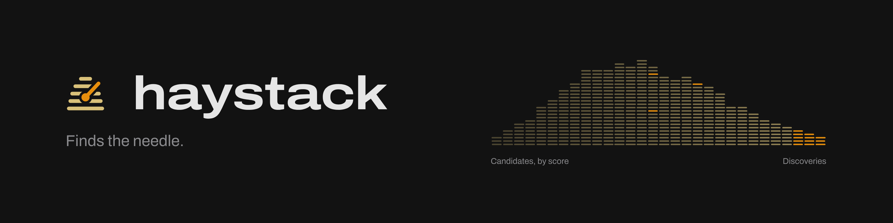
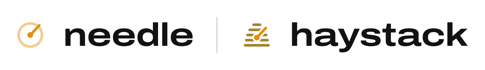

<p align="center">
  
</p>

haystack finds new music for your Spotify account by **how it sounds**. It listens to the songs you already love
(your Liked Songs, your ratings and, if you have one, your own music folder), then looks through thousands of
candidates from Deezer, ListenBrainz and [more places](#more-places-to-look-optional). Once a week it puts the closest matches into a private **Discoveries**
playlist in your Spotify account.

You don't have to do anything special: just listen. Like a song in Spotify and haystack learns from it. Let one sit
in Discoveries and it counts as a no. The next week's picks get better.

For a detailed explanation of how haystack works, and what the seven Traits needle shows (tempo, valence,
energy and the rest) mean, see [How haystack works](docs/how-it-works.md).

haystack is a small server, with no screen of its own. It runs on an always-on machine (a home server, a NAS, a
cheap VPS) and you set it up once in a single settings file, `config.toml`. Its companion app,
[needle](#needle), is where you rate songs and play what haystack found.  haystack learns based on
your Spotify likes alone.  needle is when you want to get far more granular with your ratings.

- [The easiest setup: ask your AI agent](#the-easiest-setup-ask-your-ai-agent)
- [What you need](#what-you-need)
- [Install with Docker](#install-with-docker)
- [Your music folder (optional)](#your-music-folder-optional)
- [More places to look (optional)](#more-places-to-look-optional)
- [Settings: config.toml](#settings-configtoml)
- [Day to day](#day-to-day)
- [needle](#needle)
- [Deezer notice](#deezer-notice)
- [Roadmap](#roadmap)
- [License](#license)

## The easiest setup: ask your AI agent

If you use an AI coding agent that can run commands, such as Claude Code, point it at
[AGENTS.md](AGENTS.md):

> Set up haystack for me by following https://github.com/kurtlieber/haystack/blob/main/AGENTS.md

It asks a few questions (where your music is, when you want new songs, your time zone) and does the rest. A few
steps stay yours: creating the Spotify app, typing in its two keys, and signing in to Spotify. The agent gives you
those as a short list up front. AGENTS.md has only been tested with Claude Code, but any agent that can run shell
commands should work.

Prefer to do it yourself? Read on.

## What you need

- **An always-on Linux machine with Docker**, x86_64 (Intel or AMD; ARM boards like the Raspberry Pi aren't
  supported yet). It needs about 2 GB of disk for the image, plus room for its data. It should stay on: Spotify
  only shows haystack your last 50 plays, so it checks every hour.
- **A Spotify account** and a free Spotify developer app (step 2 below), so haystack can manage its playlists.
- **Optionally, your own music folder** (`.m4a` files). With one, haystack learns your taste from far more songs
  than your Spotify likes. See [Your music folder](#your-music-folder-optional).

## Install with Docker

**1. Get the two files.** Make a folder for haystack and put the compose file and your settings in it:

```sh
mkdir -p ~/haystack/config ~/haystack/data && cd ~/haystack
curl -fsSLO https://raw.githubusercontent.com/kurtlieber/haystack/main/compose.yaml
curl -fsSL https://raw.githubusercontent.com/kurtlieber/haystack/main/config.example.toml -o config/config.toml
```

Open `compose.yaml` and set `TZ` to your time zone (for example `America/New_York`). If `id -u` doesn't print
`1000`, uncomment `user:` and put your ids there, so the files haystack writes stay yours. If you have a music
folder, set it up now too: see [Your music folder](#your-music-folder-optional).

**2. Create a Spotify app.** On the [Spotify developer dashboard](https://developer.spotify.com/dashboard), choose
**Create app**:

- Name and description: anything, such as "haystack".
- Redirect URI: exactly `http://127.0.0.1:8518/spotify/callback`.
- Which API: **Web API**.

Save, open the app's **Settings**, and keep its **Client ID** and **Client secret** at hand.

**3. Give haystack the app's keys.** Each command asks for the value without showing it:

```sh
docker compose run --rm haystack secret set spotify-client-id
docker compose run --rm haystack secret set spotify-client-secret
```

**4. Download the sound models** (Essentia's; see [License](#license) for why they aren't in the image):

```sh
docker compose run --rm haystack models fetch
```

**5. Sign in to Spotify:**

```sh
docker compose run --rm haystack auth
```

It prints a link. Open it in any browser, on your laptop or your phone, and agree. Spotify then sends you to a
page that **won't load**. That's expected. Copy the whole address from the browser's address bar (it starts with
`http://127.0.0.1:8518/spotify/callback?code=`) and paste it into the terminal within a few minutes.

**6. If you'll use needle**, make its key now ([needle](#needle) says where it goes):

```sh
docker compose run --rm haystack token new
```

**7. Start it:**

```sh
docker compose up -d
docker compose logs -f      # watch it work; Ctrl-C stops watching, not haystack
```

haystack starts collecting candidates right away. Your first Discoveries batch comes when that first collection
is done; with a music folder, it waits until the folder has been processed. After that, a new batch comes every
Monday at 08:00, or whenever you set it to.

## Your music folder (optional)

Out of the box, haystack learns your taste from your Spotify Liked Songs and your ratings. If you keep your own
music files, it can learn from those too, which gives it far more to go on.

**haystack assumes you like every song in the folder.** Point it at music you love, not at everything you own.

**What it reads.** `.m4a` files (AAC or Apple Lossless), in the folder and all its subfolders. Other formats,
such as MP3 and FLAC, are skipped for now. It only ever reads: it never changes, tags, moves or deletes a file.
Moving or renaming files later is fine; haystack recognises them by their audio.

**With Docker**, two changes:

1. In `compose.yaml`, uncomment the music line under `volumes:` and put your folder's path on the left. Leave
   `/music:ro` on the right (`ro` makes it read-only):

   ```yaml
       volumes:
         - ./config:/config
         - ./data:/data
         - /srv/music:/music:ro        # your music folder : where haystack sees it
   ```

2. In `config/config.toml`, tell haystack where it sees the folder:

   ```toml
   [library]
   root = "/music"
   ```

Then run `docker compose up -d` (not `restart`: a changed `compose.yaml` needs `up`). The container runs as uid
1000 (or your `user:`), so that user needs read access to the folder.

**Without Docker**, set `root` to the folder's real path, such as `root = "/srv/music"`.

**The first pass takes a while.** haystack listens to every file once, in nine 30-second slices, and that's
hours of CPU for a big library. Later passes (daily at 03:15) only look at new and changed files. While it runs:

- `docker compose exec haystack haystack status` shows progress under `library`: `files`, `embedded`,
  `pending`, and an `eta_minutes` estimate.
- Discoveries waits until the folder is (almost) fully processed, so your first batch comes after this pass.
- On a small machine, lower the CPU it takes, then `docker compose restart`:

  ```toml
  [library]
  workers = 1              # files processed at once (default 6)
  threads_per_worker = 2   # threads each (default 3)
  ```

If you add the folder after haystack's first start, run `docker compose exec haystack haystack library update`
to start the first pass now rather than at 03:15.

**A disk or network share** must be mounted before haystack starts. If the folder goes missing, or turns up
empty after haystack has seen songs in it, the library job fails (and alerts, if alerts are on) rather than
forgetting your songs.

**Matching to Spotify.** For To Rip and for knowing which liked songs you already own, haystack matches files to
Spotify by ISRC, then by artist, title and length. A Spotify track ID in a file's `MusicBrainz Track Id` tag (some
rippers put it there) wins over both.

## More places to look (optional)

haystack finds its candidates in several places, called sources. Most need no setup. Four more stay idle until
you set them up, and each one sends a little to a service, named below. `haystack sources` shows how well each
source does for you, and `harvest.retired_sources` stops one.

| Source | Where it looks | Setup |
|---|---|---|
| `deezer_chart`, `deezer_editorial`, `deezer_new_releases` | Deezer's charts, genre charts and editors' new releases | none |
| `deezer_artist_radio`, `deezer_related` | Deezer's artist radio and related artists, from artists you like | none |
| `deezer_style_search` | Deezer playlists named after the styles you like most | none |
| `listenbrainz_similar` | Recordings people play next to the songs you like, from ListenBrainz | none |
| `deezer_label` | The newest albums of the record labels whose songs you keep most | none: it starts once haystack knows your kept songs' labels |
| `lastfm_similar` | Songs Last.fm finds similar to yours, and the top songs of artists similar to yours | a Last.fm API key |
| `listenbrainz_recs` | Your own weekly recommendations from ListenBrainz, made from your listening | your ListenBrainz name |
| `listenbrainz_radio` | ListenBrainz's LB Radio playlists for your top styles and artists | your ListenBrainz token |

**Last.fm.** Create a free API account at <https://www.last.fm/api/account/create> (only the API key is needed),
then store the key:

```sh
docker compose run --rm haystack secret set lastfm-api-key
```

Sent to Last.fm, with the key: the artist and title of the songs the harvest starts from (your best-rated and kept
songs first, then other liked songs and your music folder) and those artists' names.

**Your ListenBrainz recommendations.** [ListenBrainz](https://listenbrainz.org) is an open, non-profit listening
service. Sign in, connect Spotify under Settings, Music services, and let it record your listening history. Once it
has a week or two of your listening, it works out recommendations for you every week. Then tell haystack your name:

```toml
[harvest]
listenbrainz_user = "your-name"
```

Sent to ListenBrainz: your user name. ListenBrainz shows your listens and recommendations publicly anyway.

**LB Radio.** ListenBrainz asks for your user token before it makes radio playlists. Copy it from
<https://listenbrainz.org/settings/> and store it:

```sh
docker compose run --rm haystack secret set listenbrainz-token
```

Sent to ListenBrainz, with the token: the names of your top styles and of the artists the harvest starts from.

**Record labels.** `deezer_label` uses the labels Deezer lists for the albums of the songs you keep (a rating of 3
stars or more, or a like). Sent to Deezer: those label names, in its album search.

**A second source of previews.** A few songs on Deezer have no 30-second preview, so haystack can't listen to
them. With this setting it looks such a song up on Apple's iTunes Search API (no key needed) and listens to Apple's
preview instead, held in memory only, like Deezer's:

```toml
[harvest]
preview_fallback = "itunes"
```

Sent to Apple: the artist and title of each candidate that has no Deezer preview, at most one request every 3
seconds.

## Optional: a language model

A language model, the kind of AI behind chat assistants, can't hear a song, but it has read a great deal about
artists, labels and scenes. haystack can ask one about your songs, but for now only to measure whether that would
help you: nothing the model says changes your batches yet. It stays off until you turn it on.

`haystack llm judge` asks the model about every song you've already judged, 40 to a request: how likely you are
to keep each one, and why. Your verdicts stay on your server. haystack compares the answers with them and prints
how well the model told your yes from your no on its own, how much its answers add to haystack's own re-ranker,
and what the run cost. `haystack llm judge --dry-run` prints the first request and sends nothing, even while the
model is off. `haystack llm suggest --dry-run` asks the model for 100 songs you'd probably like and looks each one
up on Deezer, to count how many are real. It offers none of them.

Sent to the model's provider with each request:

- each song's artist, title, album, year, record label, top three styles, and which source found it;
- a profile of your taste: the artists you rate and like most, with how many of their songs and their mean
  stars; the artists of songs you turned down; your top styles; and the usual range of each Trait in your liked
  songs. The profile sent with a request leaves out that request's songs.

Never sent: audio, your verdicts, Spotify or Deezer ids, anything that identifies your accounts, or your other
keys.

**With Anthropic's Claude.** Install Anthropic's library with `pip install "haystack-music[llm]"` (the Docker
image doesn't include it yet), store an API key from Anthropic, and turn the model on:

```sh
haystack secret set llm-api-key
```

```toml
[llm]
enabled = true
```

The default model is Claude Opus 5.5, at $4 per million tokens in and $20 per million out (Anthropic's prices on
2026-10-20). A request for 40 songs is about 3,000 tokens in, and its reply, the model's thinking included, is
capped at 16,000 tokens out, so 40 songs cost at most about $0.33. Each run prints its tokens and cost. For
another model, set `model`, and its prices in `price_in_per_mtok` and `price_out_per_mtok`.

**With a model on your own computer.** Any server with an OpenAI-style `/chat/completions` that can answer in a
JSON schema works, such as Ollama, llama.cpp's server or vLLM. Nothing leaves your network, and no extra library
is needed:

```toml
[llm]
enabled = true
provider = "openai_compatible"
base_url = "http://127.0.0.1:11434/v1"    # Ollama on this machine; in Docker, the host's address
model = "the-model-name"
price_in_per_mtok = 0
price_out_per_mtok = 0
```

If the server asks for a key, store it as `llm-api-key`. In Docker, put `docker compose exec haystack` in front of
the commands.

## Settings: config.toml

Everything haystack does is set in `config/config.toml`. The file you downloaded lists the common settings with
their defaults. Keep only what you change: anything you leave out keeps its default. After a change, run
`docker compose restart`.

The ones people change most:

| Setting | Default | What it does |
|---|---|---|
| `batch.size` | `15` | How many new songs each batch brings. |
| `schedule.batch` | `"Mon 08:00"` | When a new batch arrives. `"Fri 18:00"`, `"Mon,Thu 08:00"` or `"daily 07:00"` work too, in your `TZ`. |
| `library.root` | `""` (none) | Your music folder: `"/music"` in Docker. See [Your music folder](#your-music-folder-optional). |
| `library.workers`, `library.threads_per_worker` | `6`, `3` | How much CPU the first pass over your music folder gets. On a small VPS, try `1` and `2`. |
| `batch.expiry_days` | `14` | A discovery you don't like leaves Discoveries after this many days. |
| `batch.max_per_artist` | `1` | Songs per artist in one batch. |
| `batch.diversity` | `0.5` | How much a batch spreads across the styles you like. `0` takes the closest matches only. |
| `spotify.discoveries_name` | `"Discoveries"` | The playlist's name. |
| `calibrate.enabled`, `calibrate.per_week` | `true`, `30` | needle's **Calibrate** list: up to this many songs a week that haystack is least sure about, for you to rate. `false` stops new ones. |
| `spotify.to_rip` | `false` | Also keep a **To Rip** playlist of songs you rate 3 stars or more that aren't in your music folder, to buy later. |
| `harvest.listenbrainz_contact` | `""` | Your email or website. ListenBrainz asks API users for one. |
| `harvest.listenbrainz_user` | `""` | Your ListenBrainz name, for your own recommendations. See [More places to look](#more-places-to-look-optional). |
| `harvest.preview_fallback` | `"off"` | `"itunes"`: listen to Apple's preview of a song Deezer has none for. See [More places to look](#more-places-to-look-optional). |
| `harvest.retired_sources` | `[]` | Candidate sources to stop using. `haystack sources` shows how well each one does for you, and by the seed it started from. |
| `harvest.seed_policy` | `"verdicts"` | Where the harvest starts looking: your 4-5 star Ratings and kept discoveries first, then your liked songs, then your music folder. `"recent"` starts from your most recent liked songs. |
| `api.allow_networks` | private ranges | Which networks may reach needle's API. Narrow it to your home network and VPN. In Docker, keep `172.16.0.0/12` if needle runs on the same machine. |
| `llm.enabled` | `false` | Let `haystack llm` ask a language model about your songs. See [Optional: a language model](#optional-a-language-model). |
| `alert.enabled` | `false` | Send a webhook when a job fails or the Spotify sign-in is running out. Set the `alert-webhook-url` secret first. |
| `alert.outbox` | `""` | Instead of the webhook, write each alert as a JSON file to this folder, for another program to send on. No secret needed. See [Alerts](docs/reference.md#alerts). |

For example, 25 songs every Friday evening, with a music folder:

```toml
[batch]
size = 25

[schedule]
batch = "Fri 18:00"

[library]
root = "/music"
```

`[schedule]` also sets when the other jobs run: `sync` (hourly), `library` (daily 03:15), `harvest` (daily
05:00) and `harvest_broad` (a wider harvest, Sundays 04:00). Any of them can be `"off"`. Every other setting, including the scoring options, is in
[docs/reference.md](docs/reference.md).

## Day to day

| To... | Run |
|---|---|
| See what haystack is doing | `docker compose exec haystack haystack status` |
| Read the log | `docker compose logs -f` |
| Get a batch right now | `docker compose exec haystack haystack batch` (add `--size 30` for a bigger one) |
| Update haystack | `docker compose pull && docker compose up -d` |
| Back up | copy the `config` and `data` folders (`config/secrets/` holds your keys) |

**Sign in again about every six months.** Spotify's sign-in lasts about six months. haystack tells you a month
ahead (in `status`, and as an alert if alerts are on). Run `docker compose exec haystack haystack auth` and
paste the address back, as in step 5.

**What counts as yes and no.** A Discoveries song you like in Spotify is a yes: it leaves Discoveries at the next
hourly check, and with `to_rip` on, it goes to To Rip if it isn't in your music folder. A song still in
Discoveries when the next batch comes is a no, played or not, because the playlist is meant to be listened
through. Songs added less than a day before are let off. Ratings in needle (1 to 5 stars, Pass, Dislike) count
too, and say more than a like. A discovery you skip in needle after 5 seconds but within 30 counts as a gentle no.

Without Docker, haystack runs as systemd user services on any Linux machine with Python 3.14 and ffmpeg. See
[docs/reference.md](docs/reference.md#running-it), which also covers every command, how the scoring works and
where the files live.

## needle

<p align="center">
  <picture>
    <source media="(prefers-color-scheme: dark)" srcset="docs/brand/svg/needle-and-haystack-on-dark.svg">
    
  </picture>
</p>

[needle](https://github.com/kurtlieber/needle) is the desktop app that goes with haystack. It plays your
Discoveries and lets you rate each song in a keystroke. haystack doesn't need it, but ratings teach haystack much
faster than likes alone. Besides Discoveries, needle has a **Calibrate** list, the songs haystack is least sure
about (rating a few of those teaches it the most), and your liked songs that have no rating yet. A song you rate
once counts on every album it's on (the original, a remaster, a best-of), so needle doesn't ask about it again.

needle talks to haystack over your network, on port 8517. To connect a needle:

1. In needle's `~/.config/needle/config.toml`, set `servers = ["http://<your server>:8517"]` under `[haystack]`.
2. Copy haystack's key into needle's token file:

   ```sh
   (umask 077; mkdir -p ~/.config/needle
    ssh <your server> 'cd ~/haystack && docker compose exec -T haystack haystack token show' > ~/.config/needle/token)
   ```

Keep the API on your home network or a VPN such as Tailscale. It isn't meant to face the internet.

## Deezer notice

Every candidate's audio is its 30-second Deezer preview (or Apple's, with `harvest.preview_fallback = "itunes"`,
for the few Deezer has none for), and most candidates come from Deezer's charts, editorial picks, artist radio,
related artists, playlists and label searches, through Deezer's public API (no key). Deezer's terms may not
allow this kind of automated use, so decide for yourself before you run haystack. haystack keeps it gentle: at most
one request per 1.1 seconds, preview audio held only in memory (never written to disk), and only the derived
numbers and a few public facts about each track (its label, release date and popularity) kept, on your own
machine. `harvest.sources` can drop the Deezer sources, but ListenBrainz and Last.fm candidates still
need their Deezer previews.

Your taste never comes from Spotify's audio: only your own files and the previews are analysed.

## Roadmap

What's coming next, and why, is described in more detail in [ROADMAP.md](ROADMAP.md). The short version:

- **More places to find music.** Deezer and ListenBrainz, and if you set them up Last.fm, your own ListenBrainz
  recommendations and the labels you like, are the candidate sources so far. More may be added.
- **needle and haystack stay two programs.** This is a deliberate design choice. haystack runs headless on one
  server (a VPS or a machine at home) and is the single source of truth for your ratings. needle runs on as many
  computers as you like, and they all share that one store. Merging them would mean one copy of your taste per
  computer, and plays missed whenever a laptop sleeps.
- **No GUI for haystack.** `config.toml` is how you set it up, and stays that way.
- **haystack's settings in needle.** Longer term, needle may get a screen for the common haystack settings.
- **Spotify sign-in from needle.** needle would sign in to Spotify on your computer (PKCE) and hand the sign-in
  to haystack, with no address to paste back.

## License

haystack is AGPL-3.0-or-later ([LICENSE](LICENSE)). It downloads Essentia's models on setup instead of shipping
them: they are for non-commercial use only (Creative Commons BY-NC), so commercial use needs a license from the
MTG. [NOTICE](NOTICE) lists what haystack uses and on which terms, Deezer's included. Security reports:
[SECURITY.md](SECURITY.md).
