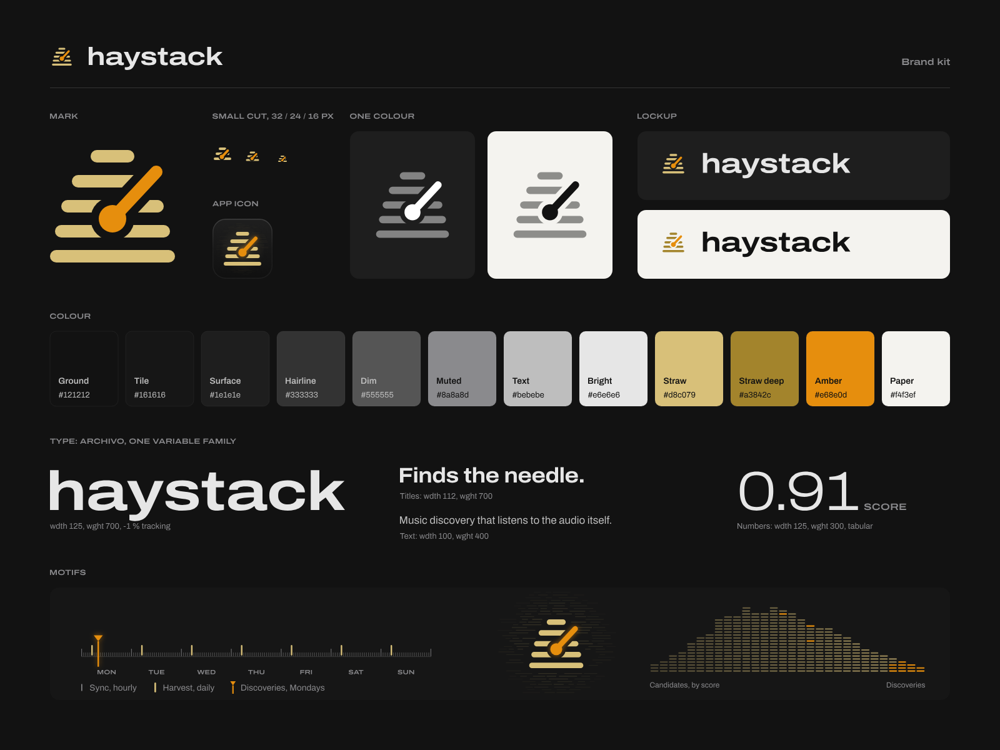

# haystack brand kit

<picture>
  <source media="(prefers-color-scheme: dark)" srcset="svg/haystack-lockup-on-dark.svg">
  
</picture>

haystack finds what needle plays, reads and judges. It has no screen of its own, so its look is needle's:
matte black, Archivo, and amber for the find, with straw beside it. Its motifs come from what it does: the week
its timers keep, the field of straws its mark stands in, and the mound of a week's candidates by score. This folder
holds that look as files for anything outside the code: sites, READMEs, link previews, slides, stickers,
wallpapers.



needle's kit (in [its `docs/brand/`](https://github.com/kurtlieber/needle/tree/main/docs/brand)) holds the
shared ground, type and amber, and this one is built from it.

## The mark

A stook of five straws on needle's 24-unit grid, with needle's own spindle and tonearm (the same dot, arm and
angle) knocked through it: the needle in the haystack. The straws are drawn in straw, the spindle and arm in amber.

- **Amber marks the find.** In both products amber is the needle: the tonearm here and in needle's mark, the
  marker on a scale, the picks in the score mound. Don't use it for anything else. Straw is everything
  around the find.
- **One colour.** White or black, with the straws at 45 % and the spindle and arm solid.
- **Light grounds.** The straws turn Straw deep (`haystack-mark-on-light.svg`); the needle stays amber.
- **Small sizes.** From 16 to 32 px use the small cut (`haystack-mark-small.svg`, `haystack-icon-small.svg`):
  three heavier straws round a bigger spindle, which hold up on pixels.
- **Clear space.** Round the mark alone, a quarter of its width. Round a lockup, the wordmark's x-height. The
  exported files include it.
- **Minimum size.** The mark at 16 px (small cut), the lockup with the word at 16 px.
- **The name.** Always lowercase, "haystack", also in running text. The wordmark is Archivo Expanded Bold.

Don't move the needle, change its angle or pull it out of the stook, add or drop straws, swap the straws' and
the needle's colours, recolour the amber, stretch or outline the mark, or add shadows (the only effect is
needle's glow). On photos or busy grounds, use the icon, which brings its own tile.

## Colour

| Name | Hex | Use |
| --- | --- | --- |
| Ground | `#121212` | The background; the word on light grounds |
| Tile | `#161616` | Cards, the icon's tile |
| Surface | `#1e1e1e` | Raised panels |
| Hairline | `#333333` | Rules, a scale's line |
| Dim | `#555555` | Minor ticks |
| Muted | `#8a8a8d` | Secondary text, major ticks |
| Text | `#bebebe` | Body text |
| Bright | `#e6e6e6` | The word, headings |
| Straw | `#d8c079` | The straws: the mark's, the field's, a harvest's |
| Straw deep | `#a3842c` | Straw on light grounds |
| Amber | `#e68e0d` | The needle and the find, nothing else |
| Paper | `#f4f3ef` | The light ground |

Dark is the default. On Paper or white the straws turn Straw deep, the needle stays amber and the word turns
Ground.

## Type

Archivo, one variable family (SIL Open Font Licence, in needle's `app/src/fonts/`). All type in the SVGs is
outlined, so they need no font installed.

| Style | Width | Weight | Tracking | Use |
| --- | --- | --- | --- | --- |
| Wordmark | 125 | 700 | -1 % | "haystack", big headings |
| Title | 112 | 700 | -2 % | Headlines, taglines |
| Text | 100 | 400 | 0 | Running text |
| Reading | 125 | 300 | -3 %, tabular | Numbers: scores, counts |
| Label | 125 | 600 | 0 | Labels, in capitals |

The line: **Finds the needle.** (needle's is "Play it. Read it. Judge it.")

## Motifs

- **The week.** needle's scale laid over a week from Monday 00:00, a tick an hour for the sync, a straw at
  each morning's harvest, and needle's marker at Monday's batch, when the new Discoveries land. It follows the
  timers in `systemd/`.
- **The field.** Loose straws in rows on the mark's grid, brightest by the mark and fading out. It is to
  haystack what a record's grooves are to needle: the ground the mark stands on in the icon, the link preview
  and the wallpapers.
- **The score mound.** A week's candidates as straws, one each, stacked in columns by score from low to high so the
  stack takes a haystack's outline. The picks are amber: the top of the high end, and a few from the middle
  for the share the batch spends exploring. It is a picture of the batch, not a chart of real numbers.

## Files

`svg/` holds the masters, `png/` the same at fixed sizes (lockups, banner and sticker at 2x), `web/` the site
icons.

| File | What it's for |
| --- | --- |
| `haystack-mark` | The mark; also `-small`, `-white`, `-black`, `-on-light` |
| `haystack-mark-animated` | For sites: the straws stack up, the needle swings in through them, then the spindle pings every 2.4 s. Still with reduced motion |
| `haystack-icon` | The mark on needle's tile, 16 to 1024 px as PNGs; `-small` for 16 to 32 px |
| `haystack-wordmark-on-dark`, `-on-light` | The word alone |
| `haystack-lockup-on-dark`, `-on-light` | The mark and the word in a row |
| `haystack-lockup-stacked-on-dark`, `-on-light` | The mark over the word |
| `needle-and-haystack-on-dark`, `-on-light` | Both products; the same files are in needle's kit |
| `haystack-social` | 1280 x 640 link preview: GitHub's social preview, Open Graph |
| `haystack-banner` | 1600 x 400 header for READMEs and sites |
| `haystack-wallpaper` | 3840 x 2160; `haystack-wallpaper-phone`, 1179 x 2556 |
| `haystack-sticker` | A round sticker, 2 in across at 300 dpi; print from the SVG |
| `haystack-pattern` | A 480 x 480 seamless tile of stooks, the needle in one of them |
| `haystack-brand-sheet` | The sheet above |

### On a site

Copy `web/` to the site's root, then:

```html
<link rel="icon" href="/favicon.ico" sizes="32x32">
<link rel="icon" href="/favicon.svg" type="image/svg+xml">
<link rel="apple-touch-icon" href="/apple-touch-icon.png">
<link rel="manifest" href="/site.webmanifest">
<meta property="og:image" content="https://example.com/haystack-social.png">
```

`favicon.svg` deepens its straws when the browser is light; `favicon.ico` can't, so it brings the icon's tile.
`site.webmanifest` names the two manifest icons and sets the theme colour to Ground.

## Rebuilding

Everything here comes from [`build.py`](build.py):

```sh
python3 docs/brand/build.py
```

It builds on needle's `docs/brand/build.py`, which holds both marks, the type and the shared layouts, so it
needs a needle checkout next to this one or `NEEDLE` set to one. Like needle's, it needs `hb-view` (HarfBuzz's
utilities) for the type and Chrome or Chromium for the PNGs (set `CHROME` to pick one).
